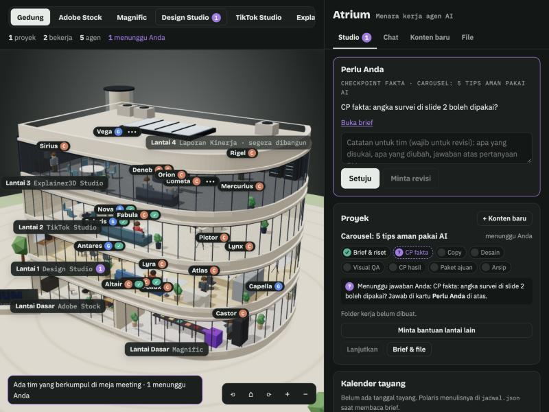

# Atrium · a 3D virtual office for a team of AI agents



Atrium is a local control room for **21 Claude Code / Gemini subagents** organised as studios on the floors of a building. Each floor runs its own production workflow: Instagram carousels, short-form motion video, 3D explainer episodes, and vector stock campaigns. The work happens in Claude Code. Atrium shows who is working on what, live in a three.js building, and stops at every **checkpoint** so a human approves before anything costly or public happens.

> All clients, brands and channels in this repo are fictional. The agent prompts are templates that you adapt to your own pipelines.

## What it does

- **Orchestrated workflows with human-in-the-loop checkpoints.** The main Claude Code session acts as orchestrator. It calls agents in order and pauses at `[CP]` stages (facts, script, storyboard, final). The owner answers *Approve / Revise* from the web panel, and the answer is logged with a revision history per client.
- **Cost gates.** Paid steps such as ElevenLabs voice-over and long renders are allowed only for the run that starts from the matching approval. The runner grants those tool permissions just for that run.
- **Per-agent model routing.** Each agent's frontmatter picks `claude` (opus/sonnet/haiku) or `gemini`.
  - Gemini agents run through a model-fallback chain (agent model → flash → flash-lite). The chain cuts a model off when the API is overloaded, so it does not sit in retry loops.
  - If every Gemini model fails, the agent falls back to Claude.
  - Heavy creative agents stay on Opus; research agents run on Gemini; mechanical agents run on Haiku.
- **Cross-floor collaboration.** A project has an owner floor, a brand and a crew. Agents can join another floor's project as **guests**: they follow the project's brand for the look and use their own skills only for technique. Any project can also *request help* from another floor, for example a fact check, trend research, a thumbnail, or an export to a second marketplace.
- **A building you can watch.**
  - Agents walk between desks, coffee and sofa with A* pathfinding.
  - They sit at their desk while working and gather at the meeting table when a checkpoint is waiting.
  - Static meshes are merged per material and shadows update round-robin. Frame time dropped from 15.2 ms to 5.4 ms.
- **Safe by default.**
  - The API answers only to localhost (Host and Origin checks).
  - Web-started runs use an explicit tool allowlist (`studio/web-permissions.json`). Anything else is denied and surfaced in the UI for approval.
  - Credentials are only read from `.env.local`.

## Architecture

```
Browser (Next.js app, office/)
  ├─ StudioThree.jsx   three.js building: floors, rooms, agents, pathfinding
  ├─ Workflow.jsx      pipeline, checkpoint cards, gallery, help requests
  └─ /api/*            state, runs (stream-json), files, permissions, works
          │
          ▼
Runner (office/lib/server/runner.js)
  spawns `claude -p --output-format stream-json` with an allowlist
  one Claude session per project, resumed on every action
          │
          ▼
Orchestrator session (CLAUDE.md + .claude/commands/*)
  ├─ Claude subagents  (.claude/agents/*.md, provider: claude)
  └─ Gemini agents     scripts/gemini-agent.mjs (model chain → Claude fallback)
          │
          ▼
projects/<slug>/status.json   ← scripts/status.mjs + hooks (working/done/checkpoint)
studio/roster.json            floors, agents, services catalog, cost gates, brands
```

| Path | What |
|---|---|
| `office/` | Next.js 16 + React 19 + three.js panel and 3D office |
| `office/lib/flows.jsx` | Workflows as data: stages, checkpoints, paid step, quick actions |
| `.claude/agents/` | 21 agent definitions (role, model, tools, rules) |
| `.claude/commands/` | `/proyek-baru`, `/lanjut`, `/checkpoint`, `/bantuan`, `/arsip` |
| `scripts/status.mjs` | The single writer of project status (atomic writes) |
| `scripts/gemini-agent.mjs` | Runs an agent on Gemini CLI with a model chain and hard timeout |
| `studio/` | Roster, client profiles, brand library, templates, permissions |

## Run the demo

Requirements: Node 20+. For real runs you also need [Claude Code](https://claude.com/claude-code) and, optionally, Gemini CLI.

```bash
npm --prefix office install
node scripts/demo.mjs            # seeds 4 fictional projects (no agents run)
npm --prefix office run dev      # http://localhost:3210  (PORT=… to change)
```

The demo shows one project waiting at a checkpoint, one video in production, an episode being researched, and a finished stock campaign. Clear it with `node scripts/demo.mjs --clean`.

To run real work, open the folder in Claude Code and start a project, either from the panel (**+ Konten baru**) or with `/proyek-baru konten <name>`.

## Notes

- The UI and the agent prompts are in Indonesian (the working language of the studio). Role titles are in English.
- `projects/`, run logs and sessions are git-ignored because they can contain client data.
- Uploading to TikTok, Instagram or stock portals is always done manually by the owner. The agents only prepare the upload package.

## License

MIT
